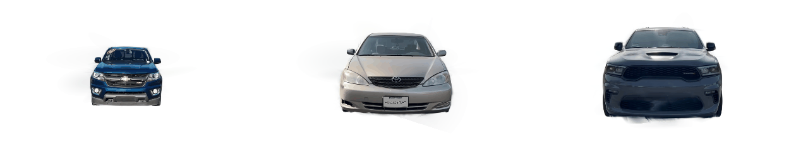
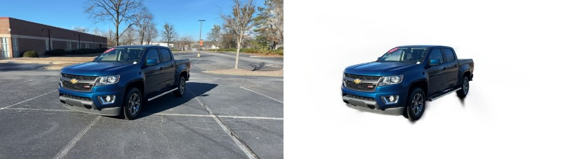
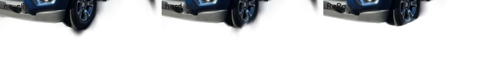

# splat-segment

Cut an object out of a trained Beta / Gaussian splat, then clip it cleanly at render time with a CUDA
implementation of **RaRa Clipper** ([Li et al., 2025](https://arxiv.org/abs/2506.20202)).



*Three cars reconstructed from 1-minute phone videos with [video-to-splat](https://github.com/neelgajera/video-to-splat),
segmented by multi-view mask voting, and rendered with the ground clipped away under the tyres.*

## 1. Segmentation: multi-view mask voting



A 2D segmenter (rembg) gives a foreground mask for every training view. Every primitive's centre is projected
into every view and labelled *inside*, *outside*, or *not visible* (behind the camera or out of frame). A
primitive is kept if it is inside the mask in **more than 80% of the views that see it** (and is seen by at
least 5).

One view is easily fooled: a ground splat right behind the car lands inside the car's silhouette. From most
other angles the same splat falls outside the mask, so the vote removes it. This is the label assignment and
multi-view ensemble of [SAGS](https://github.com/XuHu0529/SAGS), re-implemented for Beta splats with masks from
any segmenter ([`splatseg/vote.py`](splatseg/vote.py)).

| Capture (300k primitives each) | Kept | 2D masks (180 views, CPU) | Voting (GPU) |
|---|---|---|---|
| Chevy Colorado | 50,132 | 139 s | 0.55 s |
| Toyota Camry | 62,739 | 110 s | 0.42 s |
| Dodge Durango | 54,333 | 118 s | 0.47 s |

## 2. Clipping: RaRa Clipper in CUDA

Voting is per primitive, but primitives are volumes. Splats at the contact between the car and the ground
are half car and half ground, and no keep/drop decision is right for them. A clipping plane has the same
problem:

* **Hard clipping** keeps or drops each primitive by its centre, so primitives just above the plane still
  hang below it as dark drips.
* **RaRa Clipper** classifies primitives against the plane by their support radius. Primitives the plane
  cuts are still rasterized, but each pixel's alpha is scaled by the **fraction of the camera ray's chord
  through the primitive that lies on the kept side** (paper Eqs. 11–12): α' = α · L_visible / L_chord.



The plane here is the scene's ground: its normal is the cameras' mean up vector, and its height is the 1st
height percentile of the cut-out car, i.e. where the tyres touch the ground.

### Implementation ([`csrc/rara_rasterize.cu`](csrc/rara_rasterize.cu), [`splatseg/rara.py`](splatseg/rara.py))

- A forward-only tile rasterizer adapted from gsplat's `rasterize_to_pixels_fwd` (Beta-kernel variant), with
  a per-pixel ray/ellipsoid test for the primitives the plane cuts. It plugs into gsplat's `rasterization()`
  through a context manager, so projection, sorting and spherical-beta colour are unchanged.
- **Beta kernels have compact support** (zero at Mahalanobis distance 1), so the ellipsoid is exactly the one
  with semi-axes equal to the primitive's scales, where the paper uses 3σ for Gaussians. The chord weight is
  therefore exact, not an approximation.
- **Rim fix.** gsplat dilates each 2D footprint (antialiasing) and projects it with an affine approximation,
  so some footprint pixels have rays that miss the 3D ellipsoid. The paper sets w = 1 there; with compact
  kernels that lights up the rims of mostly-clipped primitives as speckles. Here, such rays use the side of
  the plane at their closest approach to the primitive.

| Render (laptop RTX 3060), 50k primitives, 3–5k cut | No clip | Hard clip | RaRa clip |
|---|---|---|---|
| 788 × 443 | 6.4 ms | 4.7 ms | 7.1 ms |
| 1577 × 887 | | | 13.1 ms |

RaRa stays real time: it only does extra work for the few thousand primitives the plane actually cuts.

### Tests ([`tests/test_rara.py`](tests/test_rara.py))

- With a plane that cuts nothing, the RaRa kernel reproduces gsplat's own render of a real model to **< 1e-5**.
- The chord-weight formula matches dense sampling along the ray on 200 random ellipsoid/plane/ray cases.

## Usage

```bash
git clone --recursive https://github.com/neelgajera/splat-segment && cd splat-segment
# environment with PyTorch + CUDA and beta-splatting installed (see video-to-splat's setup), then:
pip install -r requirements.txt
python setup.py build_ext --inplace           # builds splatseg._C (RaRa kernel)

python segment.py   --ply model.ply --dataset runs/car/dataset --out out/car            # cut out the object
python clip_demo.py --ply out/car/object.ply --dataset runs/car/dataset --plane ground --out out/car
python turntable.py --scene out/car/object.ply runs/car/dataset --out docs/turntable.gif
```

`--dataset` is the COLMAP-format folder the model was trained on (`images/`, `sparse/0/`). `--plane` also
takes `a,b,c,d` for any plane `ax + by + cz + d = 0` (kept side > 0).

## Limitations

- Voting uses primitive centres, so very large primitives straddling the object boundary are kept or dropped
  whole. RaRa clipping handles this for planes, but not yet for arbitrary mask boundaries.
- RaRa here handles one plane, as in the paper. Boxes and other convex clip volumes would only need a
  different ray/volume intersection.
- A splat captured from outside is a shell, so cutting *through* an object exposes an unreconstructed
  interior. Planes are most useful for removing ground, walls and backgrounds.

## Background

At Spyne I built 3D car segmentation the same way: multi-view mask voting, then render-time clipping in
the RaRa style. This is an independent re-implementation, written from scratch on public tools and my own
captures. It contains no Spyne code, models or data.

## License

Apache-2.0. `csrc/rara_rasterize.cu` adapts gsplat (Apache-2.0) and Deformable Beta Splatting (Apache-2.0).
RaRa Clipper is the method of Li, Jia, Rajeh, Engel and Viola, [arXiv:2506.20202](https://arxiv.org/abs/2506.20202).
